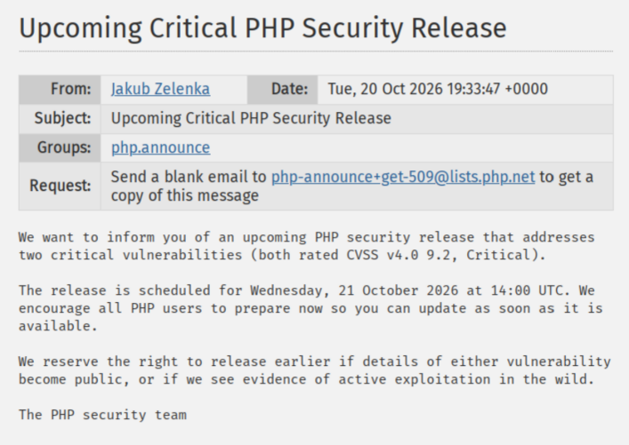
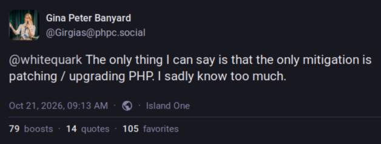
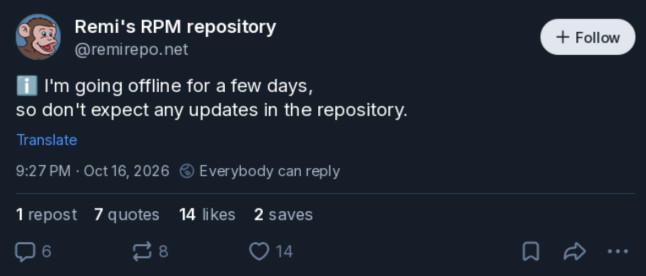
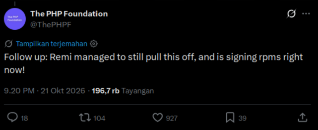

Pada tanggal 21 Oktober 2026, grup PHP mengumumkan adanya celah keamanan kritis
yang dikenal dengan sebutan PHP2Shell. Celah ini memungkinkan penyerang
menjalankan kode pada situs web yang menggunakan bahasa pemrograman PHP.

Saya banyak berurusan dengan PHP. Kadang saya menjadi arsitek, kadang saya
*programmer*, kadang saya *system administrator*, kadang *security auditor*. Jadi saya
terlibat dengan sangat banyak aplikasi PHP, baik dari sisi pengembangan maupun
pengelolaannya. Berikut adalah cerita di balik layar penanganan celah keamanan
PHP2Shell pada tanggal 21 Oktober 2026 yang lalu.

<!-- truncate -->

## Tanggal 21 Oktober 2026, 02:33 WIB

Grup PHP mengumumkan ditemukannya celah keamanan kritis yang dikenal dengan
sebutan PHP2Shell. Mereka menjadwalkan bahwa rilis akan dilakukan pada pukul
21.00 WIB, pada hari itu juga (zona waktu WIB). Dengan kata lain, hanya ada
waktu kurang lebih 18 jam untuk melakukan persiapan sebelum mereka melakukan
rilis tersebut.



Dalam dunia perangkat lunak, prosedur tersebut dinamakan "pengumuman keamanan
terkoordinasi", atau [*coordinated vulnerability
disclosure*](https://en.wikipedia.org/wiki/Coordinated_vulnerability_disclosure)
(CVD). Tujuannya adalah memberikan waktu bagi pengembang, vendor, distributor,
dan pihak terkait lainnya untuk menyiapkan perbaikan sebelum celah keamanan
tersebut diumumkan secara publik.

Biasanya CVD dijadwalkan dengan rentang waktu cukup lama, misalnya dua minggu
atau lebih, untuk memberikan cukup waktu bagi semua pihak terkait menyiapkan
perbaikan dan mitigasi sebelum celah keamanan diumumkan secara publik. Namun,
untuk kasus ini, mereka hanya memberi waktu kurang dari satu hari, mungkin
karena sifat celah keamanan ini sangat kritis dan ada potensi ada pihak yang
akan membocorkan celah keamanan ini sebelum perbaikan tersedia.

## Tanggal 21 Oktober 2026, sekitar pukul 11:00 WIB

Saya baru mendapatkan kabar tentang celah keamanan PHP2Shell ini. Waktu yang
tersisa sebelum rilis resmi hanya sekitar 10 jam. Dari spekulasi yang beredar di
Internet, celah keamanan ini terkait dengan fitur *upload progress*, dan
mitigasi dapat dilakukan dengan menonaktifkan fitur *upload progress* sementara
hingga perbaikan resmi tersedia.

Dengan demikian, saya menetapkan langkah mitigasi adalah dengan menonaktifkan fitur *upload progress*
dengan menggunakan konfigurasi sebagai berikut.

```ini title="php.ini"
session.upload_progress.enabled = 0
```

Saya buat *script* untuk secara otomatis menerapkan perubahan konfigurasi tersebut
pada semua file `php.ini` yang ada di server.

## Tanggal 21 Oktober 2026, sekitar pukul 14:00 WIB

Rekan memberikan informasi bahwa rencana mitigasi yang saya rencanakan tidaklah
cukup untuk melindungi server dari potensi eksploitasi celah keamanan PHP2Shell.



Baiklah, artinya ini sangat serius. Jika satu-satunya jalan adalah *update*,
maka untuk memastikan tidak ada masalah, akan ada *downtime* antara beberapa
menit sampai dengan beberapa jam setelah pukul 21.00 WIB nanti.

Dua jam ke depan dihabiskan untuk menghubungi *stakeholder* dan pihak terkait
lainnya, membuat pengumuman, membuat daftar sistem yang akan ditangani, dan
memastikan semua sistem tersebut dapat diakses.

:::info FAQ
***Q: Kenapa kok mendadak? Kenapa kami tidak diberi tahu dari beberapa hari lalu?***

A: Bukan saya yang membuat jadwal ini. Keputusan ini diambil oleh Grup PHP. Saya
hanya melakukan eksekusi sesuai jadwal tersebut. Bersyukurlah bahwa jadwal yang
diberikan sangat menyenangkan untuk orang Indonesia. Di negara lain, jadwal
bersinggungan dengan jam sibuk mereka, dan akan terjadi gangguan yang jauh lebih
besar.

Jika anda tidak bersedia untuk melakukan *update* sesuai jadwal yang ditentukan,
maka saya tidak bertanggung jawab atas konsekuensi yang mungkin timbul.

:::

## Tanggal 21 Oktober 2026, sekitar pukul 15:30 WIB

Rekan mengabarkan bahwa ada eksploit yang sudah bocor ke publik. Saya coba
eksploitnya ke beberapa sistem yang saya tangani, dan tidak berhasil. Saya
putuskan untuk tetap melanjutkan rencana *update* sesuai jadwal yang telah
ditentukan.

## Tanggal 21 Oktober 2026, sekitar pukul 16:00 WIB

Merumuskan rencana eksekusi, garis besarnya adalah:

1. Pada pukul 21:00 WIB, matikan semua layanan PHP.
2. Lakukan *update*.
3. Nyalakan kembali semua layanan PHP setelah *update* selesai.
4. Verifikasi layanan sudah normal.
5. Lakukan *scan* untuk memastikan celah keamanan telah diperbaiki.

Garis besarnya sederhana, tetapi di lapangan menjadi sangat rumit, terutama
*point* nomor 2. Untuk kasus saya:

- Ada beberapa arsitektur: *distro-native*, *shared hosting*, *container*.
- Ada banyak versi *distro*: EL6, EL7, EL8, EL9, EL10.
- Ada beberapa sumber paket: *distro*, pihak ketiga, dan buatan sendiri.
- Ada banyak versi PHP, mulai dari 5.2 sampai 8.6.
- PHP hanya memberi *update* untuk versi 8.2 ke atas, ada banyak kasus saya harus
  melakukan *backport* sendiri.

Untuk RPM, saya melakukan gladi resik untuk rekompilasi dari SRPMS menjadi RPMS
untuk memastikan semua paket dapat dikompilasi dengan sukses dan siap digunakan
setelah *update*. Proses rekompilasi untuk satu paket membutuhkan waktu sekitar
40 menit.

## Tanggal 21 Oktober 2026, sekitar pukul 17:00 WIB

Mendapat kabar bahwa Remi Collet ternyata sedang libur sejak tanggal 16 Oktober.
Remi adalah pengelola [paket RPM untuk PHP](https://rpms.remirepo.net/) yang
sangat populer di kalangan pengguna distribusi Linux berbasis Red Hat. Paket RPM
dari Remi saya gunakan untuk mengelola instalasi PHP di berbagai sistem yang
saya tangani.



Dengan demikian kita harus pindah ke *plan B*. Agar sistem yang menggunakan
Remirepo tetap mendapat *update*, saya akan buat RPMnya sendiri dari SRPMS-nya.
Semua SRPMS terkait langsung saya unduh. Lalu saya buat beberapa *instance* untuk
untuk versi *distro* yang diperlukan, dan memastikan semua bisa melakukan
kompilasi dari `src.rpm` menjadi RPM dengan sukses.


## Tanggal 21 Oktober 2026, sekitar pukul 18:00 WIB

Tidur.

Ada banyak masalah terjadi karena programmer atau sistem admistrator kurang
tidur. Dan banyak teman-teman yang meremehkan hal ini. Sebelum melakukan
pekerjaan yang kompleks dan kritis, pastikan tubuh dan pikiran dalam kondisi
prima.

## Tanggal 21 Oktober 2026, pukul 21:00 WIB

Eksekusi rencana dimulai. Semua layanan PHP dimatikan. Semua *container* yang
menjalankan PHP dimatikan. Untuk *host deployment*, strateginya adalah mematikan
semua *binary* PHP dengan `chmod 0`. Jika sudah ada *update*, maka *binary* akan
otomatis memiliki izin yang sesuai setelah *update* selesai.

Saya tugaskan AI untuk melakukan hal-hal berikut ini:

1. Memantau [*image* resmi Docker](https://hub.docker.com/_/php), dan melaporkan
   jika sudah ada rilis versi baru dari *image* PHP.
2. Melakukan *backport* *patch* untuk semua versi PHP di bawah 8.2, mulai dari 5.2
   hingga 8.1.
3. Memantau apakah RedHat sudah merilis *update* untuk PHP. Walaupun saya jarang
   menggunakan paket resmi RHEL, *patch* yang mereka rilis mungkin akan
   bermanfaat untuk tugas nomor 2.
4. Melakukan kompilasi semua SRPMS yang sudah ada *update*-nya, baik yang resmi,
   dari pemaket pihak ketiga (RedHat), atau hasil *backport* oleh AI di langkah
   nomor 2. Yang disukai tentunya adalah *update* resmi, lalu *patch* dari vendor
   terkemuka seperti RedHat, *patch* pihak ketiga dari komunitas, setelah itu baru
   *patch* hasil *backport* oleh AI.

Untuk RPM, setiap kali kompilasi berhasil, hasilnya dapat langsung di-*push* ke
repositori, bisa langsung diterapkan untuk *update* sistem yang membutuhkan, dan
akan langsung otomatis kembali berfungsi.

Untuk *image container*, saya memutuskan untuk menunggu *update* resmi dari Docker
Hub. Sementara itu sistem tetap *offline* sampai *update* dirilis.

## Tanggal 21 Oktober 2026, sekitar pukul 22:00 WIB

Mendapat kabar bahwa Remi ternyata berhasil melakukan *update* di tengah
liburannya. Saat ini sedang dalam proses *signing* yang memakan waktu yang lama
karena jumlah paket yang sangat banyak.



Saya langsung instruksikan agen AI untuk berhenti melakukan rekompilasi untuk
paket-paket Remi, dan beralih fokus ke paket-paket non-Remi atau paket Remi yang
tidak lagi mendapatkan *update*.

Setelah paket-paket baru dipublikasikan, masalah belum selesai. Saya masih harus
menunggu paket selesai di-*push* ke *mirror*. Saya tugaskan AI untuk mencari *mirror*
yang sudah mendapatkan paket-paket terbaru, lalu saya unduh manual, dan
melakukan instalasi ke semua server secara manual, tanpa bantuan `dnf` atau
`yum`.

## Tanggal 21 Oktober 2026, sekitar pukul 23:00 WIB

Docker Hub baru mempublikasikan *update* untuk *image* PHP dua jam setelah
pengumuman resmi PHP. Sekarang waktunya untuk menangani proyek dengan arsitektur
*container*.

Bagi proyek yang menggunakan *image* resmi apa adanya, yang perlu dilakukan
hanyalah `docker pull` dan kembali menjalankan *container* dengan *image* yang sudah
diperbarui. Tapi yang bisa begini mungkin hanya proyek yang hanya membutuhkan
MySQL/MariaDB.

Masalah terjadi untuk *image custom*: infrastruktur PECL mati, kemungkinan karena
ada banyak orang lain di luar sana yang melakukan hal yang sama. Umumnya terjadi
karena *image* membutuhkan ekstensi yang bukan bagian dari PHP resmi. Untuk kasus
saya, extensi yang terkait di antaranya adalah `redis`, `imagick`, dan `amqp`.

Karena PECL mati, proses pembuatan *image* tidak bisa diselesaikan. Solusi yang
saya lakukan adalah mengambil *source code* ekstensi yang dibutuhkan secara
langsung dari GitHub.

Yang merepotkan adalah proyek yang memiliki `Dockerfile` untuk melakukan
instalasi ekstensi, apalagi jika posisi saya hanya *sysadmin*, bukan pengembang.
Untuk memperbaiki celah keamanan, mau tidak mau harus memodifikasi `Dockerfile`,
yang sebenarnya adalah tanggung jawab pengembang proyek, bukan *sysadmin*.

:::tip

Pengembang proyek? Jangan gunakan `Dockerfile` atau `Containerfile` untuk
melakukan kustomisasi PHP. Buat proyek terpisah untuk membuat *image*-nya, lalu
simpan hasilnya di *container registry*. Kemudian baru gunakan *image* tersebut di
`Dockerfile`/`Containerfile` atau `compose.yaml`.

Jaman sekarang yang paling mudah (dan gratis) adalah menggunakan GitHub, dengan
*container registry* di `ghcr.io`.

:::

:::info

Konsekuensi dari metode pengembangan DevOps adalah bahwa tanggung jawab untuk
*update* kini berada di tangan pengembang, bukan tim infrastruktur. Ini yang
tidak dipahami oleh banyak *stakeholders*.

Seorang *sysadmin* bisa saja melakukan *update*, tetapi akan menyentuh kode yang
dibuat pengembang, dan belum tentu sesuai dengan prosedur yang seharusnya
diikuti.

:::

## Tanggal 22 Oktober 2026, sekitar pukul 00:00 WIB

Semua proyek berbasis *container* yang saya termasuk pengembangnya sudah
menggunakan *image* yang diperbaharui dan sudah kembali berjalan normal. Lama
*downtime* akibat masalah ini adalah 2-3 jam.

## Tanggal 22 Oktober 2026, sekitar pukul 01:00 WIB

Semua server *shared hosting* dan proyek dengan arsitektur *distro-native*
di-*update* secara bertahap sejak awal pengumuman resmi PHP. Dan semua selesai
pada pukul 01:00 WIB.

Yang tidak dapat di-*update* adalah versi PHP sangat lama yaitu 5.2 dan 5.3.
Penggunanya saya pindahkan ke versi 5.6 atau 7.4. Jika ada hal yang tidak
kompatibel, saya tawarkan untuk diperbaiki dengan AI. Jika mustahil untuk
*upgrade*, misalnya karena *source code* yang dienkripsi, maka saya tawarkan untuk
pindah ke arsitektur *container*.

:::info FAQ

***Q: Kenapa kok masih menggunakan versi PHP lama?***

A:

- Untuk proyek yang saat ini aktif saya tangani semuanya sudah menggunakan versi
  PHP 8.5.
- Untuk proyek orang lain yang saya hanya *sysadmin*-nya, hal tersebut bukan
  wewenang saya. Saya hanya bisa memberikan rekomendasi, tetapi keputusan ada di
  tangan *stakeholder*.
- Ada banyak proyek PHP yang kontraknya tidak menyertakan *source code*, dan
  *deliverable*-nya adalah kode yang dienkripsi, misalnya menggunakan ionCube
  atau Zend Guard.

:::

## Tanggal 22 Oktober 2026, sekitar pukul 10:00 WIB

Mulai ada reaksi dari berbagai pihak. Yang paling bising adalah *pentester*.
Biasanya mereka melakukan *scanning* terhadap situs web yang diuji. Lalu jika
*output*-nya memiliki *header* `X-Powered-By: PHP/8.1.34`, maka mereka keliru
menyimpulkan bahwa situs web tersebut rentan terhadap celah keamanan PHP2Shell.

Grup PHP merilis PHP 8.5.12, 8.4.27, 8.3.36 and 8.2.35 untuk menutup celah
keamanan PHP2Shell. Lalu mereka simpulkan bahwa versi di bawah itu pasti rentan
terhadap celah keamanan tersebut. Benarkah? Keliru, karena kita telah melakukan
[*backport*](https://en.wikipedia.org/wiki/Backporting) *patch* untuk menutup
celah keamanan tersebut pada versi PHP yang lebih lama.

Solusi saya adalah hanya dengan mematikan *header* `X-Powered-By` dengan
menggunakan konfigurasi:

```ini php.ini
expose_php = Off
```

Hal ini tidak akan mengubah apapun dari sisi keamanan. Tetapi jika sang "ahli
keamanan digital" mengklik tombol "Scan" pada *software scanner* yang mereka
gunakan, *software* tidak akan menandai situs kita sebagai rentan terhadap celah
keamanan PHP2Shell.

:::info FAQ

***Q: Mengapa melakukan backport, mengapa tidak gunakan versi lebih baru saja?***

A: Menggunakan versi lebih baru tidak selalu memungkinkan. Aplikasi belum tentu
kompatibel dengan versi terbaru, dan membutuhkan pengujian untuk memastikan
aplikasi kompatibel sebelum kita dapat melakukan *upgrade* ke versi PHP yang lebih
baru.

## Tanggal 22 Oktober 2026, sekitar pukul 20:00 WIB

Melakukan scanning terhadap situs web yang saya tangani dengan
[php2shell-scanner](https://github.com/assetnote/php2shell-scanner). Hal ini
untuk memastikan bahwa celah keamanan PHP2Shell telah berhasil ditutup.
