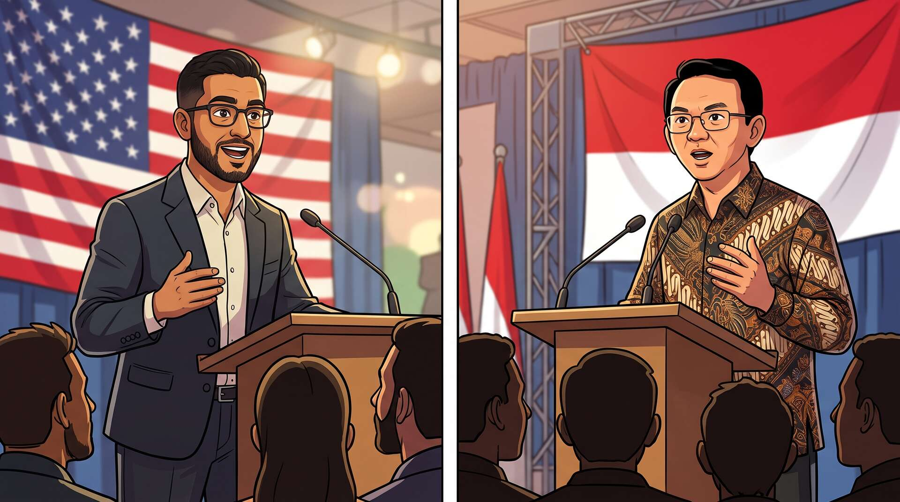

Tanggal 1 Januari 2026, [Zohran Mamdani](https://en.wikipedia.org/wiki/Zohran_Mamdani) dilantik menjadi [Walikota New York City](https://en.wikipedia.org/wiki/Mayor_of_New_York_City).
Tanggal 1 Januari 2027 mendatang, [Abdul El-Sayed](https://en.wikipedia.org/wiki/Abdul_El-Sayed) akan dilantik menjadi anggota
[senat Amerika Serikat](https://en.wikipedia.org/wiki/United_States_Senate). Mereka adalah minoritas, bukan orang kulit putih
kaukasian, dan beragama Islam, bukan mayoritas kristen. Tetapi mereka mendapat
dukungan dari rakyat di dapilnya masing-masing. Selain Mamdani dan El-Sayed, ada
beberapa politisi lain yang situasinya mirip, misalnya [Ilhan Omar](https://en.wikipedia.org/wiki/Ilhan_Omar) dan
[Rashida Tlaib](https://en.wikipedia.org/wiki/Rashida_Tlaib).

Banyak media massa di Indonesia ikut 'merayakan' kemenangan mereka. Mengapa?
Rata-rata hanya karena mereka melihat Mamdani dan El-Sayed beragama Islam. Tapi
jangan keliru, di Indonesia, politisi terkenal yang paling mirip dengan El-Sayed
dan Mamdani adalah [Ahok](https://en.wikipedia.org/wiki/Basuki_Tjahaja_Purnama).

<!-- truncate -->

Baik El-Sayed, Mamdani, dan Ahok Jakarta 2014 semuanya memiliki platform politik
[populis kiri](https://en.wikipedia.org/wiki/Left-wing_populism). Mereka adalah minoritas ganda karena sama-sama bukan ras
mayoritas, dan juga bukan penganut agama mayoritas.

Ironisnya adalah bahwa banyak pihak yang sekarang dengan gegap gempita
mengelu-elukan Mamdani dan El-Sayed adalah pihak yang sama yang sering
mendiskreditkan Ahok satu dekade yang lalu. Kalau diperhatikan, umumnya mereka
adalah kelompok [sayap kanan](https://en.wikipedia.org/wiki/Right-wing_politics) berbasis agama, yang mirip dengan gerombolan [MAGA](https://en.wikipedia.org/wiki/Make_America_Great_Again) di
Amerika Serikat.

Sama seperti Ahok 10 tahun lalu, Mamdani dan El-Sayed saat ini juga sedang
mendapat serangan bertubi-tubi dari gerombolan sayap kanan.

Apa yang akan terjadi jika misalnya El-Sayed dan Mamdani ikut pemilihan umum di
Indonesia dengan platform politik dan program kerja yang sama? Mereka juga akan
mendapatkan gempuran bertubi-tubi dari gerombolan sayap kanan lokal, walaupun di
sini mereka menjadi penganut agama mayoritas.
