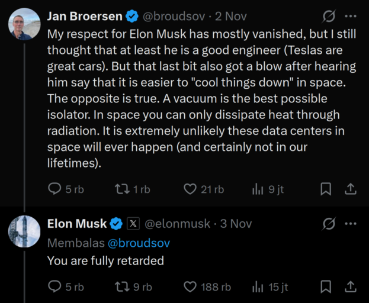

Terdapat wacana untuk meluncurkan *datacenter AI* ke luar angkasa. Bayar
roketnya, daya didapatkan dari panel surya, lalu buang panasnya dengan radiator.
Imbalannya, tak ada lagi urusan dengan jaringan listrik, lahan, air pendingin,
dan izin dari warga sekitar.

Tulisan ini menghitung apakah pertukaran itu sepadan. Semua angka di halaman ini
dihitung langsung dari asumsinya, dan asumsi itu bisa diubah: pilih skenario
lain yang telah ditentukan, atau geser nilai di dekat setiap ilustrasi.

{/* truncate */}

import {
  Assumptions,
  BreakEven,
  CalculatorLink,
  CarbonBreakEven,
  CarbonFigure,
  CarbonSummary,
  CostFigure,
  CostSummary,
  DragSummary,
  FootprintFigure,
  HeatSummary,
  LaunchCostFigure,
  Lede,
  LifetimeFigure,
  MassFigure,
  MassSummary,
  OrbitFigure,
  PowerSummary,
  RadiatorFigure,
  ScenarioBar,
  WaitingSummary,
  WaterSummary,
} from '@site/src/components/OrbitalDatacenter';

<ScenarioBar />

<Lede />

## Daya

Di orbit, matahari bersinar tanpa awan dan tanpa malam yang panjang. Tetapi
orbit rendah berarti stasiun berulang kali masuk bayangan Bumi, dan komputer
tidak boleh padam selama itu.

<PowerSummary />

<OrbitFigure />

Sudut β adalah sudut antara arah matahari dan bidang orbit. Pada β = 90° stasiun
terbang di sepanjang batas siang dan malam, tidak pernah masuk bayangan, dan
tidak butuh baterai. Orbit semacam itu hanya ada di dekat kutub, dan sudutnya
bergeser menurut musim.

## Panas

Di darat, panas dibawa pergi oleh udara dan air. Di ruang hampa tidak ada
keduanya. Satu-satunya jalan keluar bagi panas adalah dengan cara memancarkannya
sebagai cahaya inframerah dari permukaan yang luas.

<HeatSummary />

<RadiatorFigure />

Radiator tidak bisa lebih panas daripada perangkat yang didinginkannya, dan
tidak menghadap ruang hampa yang dingin saja: Bumi di bawahnya ikut memanasinya.
Itu sebabnya suhu lingkungan efektif di orbit rendah jauh di atas suhu
antariksa.

## Massa dan peluncuran

Panel surya, baterai, radiator, dan unit komputasi harus diluncurkan ke orbit, dan
setiap kilogram yang diluncurkan akan menambah ongkosnya.

<MassSummary />

<MassFigure />

<FootprintFigure />

## Bertahan di orbit

Pada ketinggian ratusan kilometer masih terdapat sisa atmosfer. Bentangan panel
dan radiator yang luas menangkapnya seperti layar kapal di laut, dan stasiun
akan pelan-pelan kehilangan ketinggian kecuali jika terus didorong.

<DragSummary />

<LifetimeFigure />

Orbit yang lebih tinggi hampir bebas hambatan, tetapi sampah antariksa di sana
juga bertahan jauh lebih lama.

## Biaya

<CostSummary />

<CostFigure />

Perangkat keras memiliki kemampuan komputasi yang sama, jadi biayanya pun hampir
sama di kedua tempat. Bedanya ada di sekelilingnya: orbit membayar wahana dan
peluncuran, sedangkan darat membayar gedung, listrik, dan perizinan.

### Menunggu itu mahal

Komputasi yang baru menyala beberapa tahun lagi bernilai lebih rendah daripada
komputasi yang menyala hari ini, karena sudah dapat langsung mendapatkan
pemasukan. Jadi siapa yang lebih cepat mendapat daya ikut menentukan siapa yang
lebih murah.

<WaitingSummary />

### Seberapa murah peluncuran harus jadi?

Biaya peluncuran adalah angka yang paling sering disebut para pendukung gagasan
ini. Grafik berikut mengubah biaya itu saja, dari yang termurah sampai yang
termahal, dan membiarkan asumsi lain tetap.

<LaunchCostFigure />

<BreakEven />

## Karbon dan air

Stasiun di orbit tidak membakar apa pun selama bekerja. Emisinya terjadi di
muka: saat perangkat dan wahananya dibuat, dan saat roketnya diluncurkan. Pusat
data di darat sebaliknya: emisinya mengalir terus bersama listrik yang
digunakannya.

<CarbonSummary />

<CarbonFigure />

<CarbonBreakEven />

<WaterSummary />

## Yang tidak dihitung

Model ini menyederhanakan banyak hal. Berikut adalah hal-hal tidak masuk hitungan, dan
hampir semuanya akan memberatkan orbit:

- [pengerasan terhadap radiasi](https://en.wikipedia.org/wiki/Radiation_hardening)
  dan [galat](https://en.wikipedia.org/wiki/Single-event_upset) akibat
  [partikel berenergi tinggi](https://id.wikipedia.org/wiki/Sinar_kosmik),
  termasuk massa perisainya;
- perlindungan terhadap
  [mikrometeoroid](https://id.wikipedia.org/wiki/Mikrometeoroid) dan
  [sampah antariksa](https://id.wikipedia.org/wiki/Sampah_antariksa);
- [dinamika struktur](https://en.wikipedia.org/wiki/Structural_dynamics)
  bentang berukuran kilometer persegi;
- bayangan panel surya yang jatuh ke radiator;
- [lebar pita](https://id.wikipedia.org/wiki/Lebar_pita) sambungan data ke Bumi;
- servis atau perbaikan di orbit: perangkat yang rusak dianggap hangus dan
  diganti, tidak pernah diperbaiki;
- berkurangnya muatan roket untuk orbit yang lebih tinggi atau
  dengan [inklinasi](https://id.wikipedia.org/wiki/Inklinasi) yang lebih besar;
- risiko tabrakan dan
  [manuver penghindaran](https://en.wikipedia.org/wiki/Collision_avoidance_%28spacecraft%29);
- pembuangan stasiun di akhir masa pakainya.

## Semua asumsi

Setiap angka di atas berasal dari asumsi berikut. Semuanya bisa diubah, dan
perubahannya langsung berlaku di seluruh halaman.

<Assumptions />

Skenario yang sama bisa dibuka di <CalculatorLink>kalkulator
lengkapnya</CalculatorLink>, yang memuat rumus dan rujukan untuk setiap angka.

## Tentang hitungan ini

Model di balik angka-angka ini sama persis dengan yang dipakai
[Orbital AI Datacenter Calculator](https://priyadi.github.io/orbital-ai-datacenter/?lang=id);
kodenya disalin apa adanya. Model itu dibuat dengan bantuan AI dan belum
diperiksa secara independen, jadi perlakukan hasilnya sebagai bahan diskusi,
bukan sebagai kesimpulan.

## Kesimpulan

Hampir semua skenario menyimpulkan bahwa *datacenter AI* di orbit tidak ekonomis
dibandingkan *datacenter AI* di darat. Namun belum tentu selamanya akan
demikian.

Jika izin mendirikan *datacenter AI* semakin sulit diperoleh, mungkin suatu saat
akan mustahil untuk dapat mendirikan *datacenter AI* di mana pun di permukaan
Bumi. Jika sudah demikian, meluncurkan *datacenter AI* ke luar angkasa adalah
salah satu dari sedikit opsi yang masih tersedia. Biaya yang mahal tidak lagi
menjadi masalah apabila tidak harus bersaing dengan *datacenter AI* di permukaan
Bumi.
