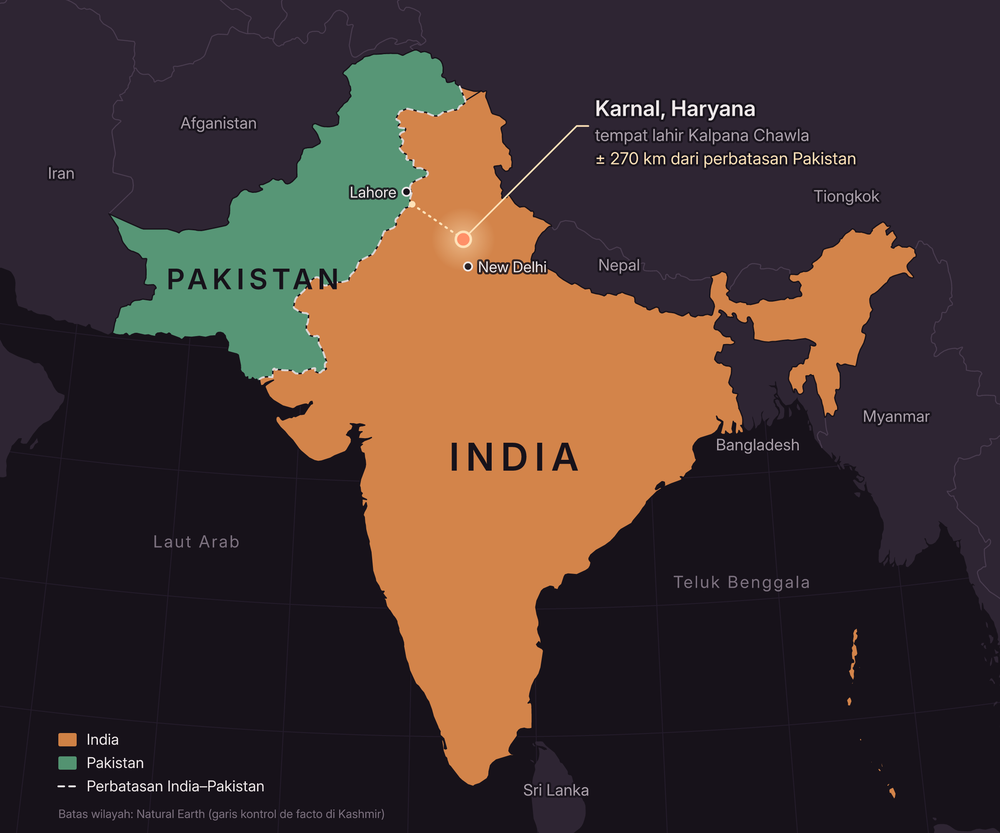

Selama ribuan tahun, loyalitas adalah salah satu sifat manusia yang paling
berharga, dan bukan tanpa alasan. Manusia awalnya hidup dalam kelompok suku yang
kecil. Mereka berburu, makan dan bepergian bersama-sama. Beberapa generasi akan
hidup di dalam kelompok tersebut, membentuk ikatan yang kuat antara anggota dari
suku tersebut. Tetapi kemudian umat manusia berkembang dan meninggalkan sifat
nomadennya; kita mulai menetap di desa-desa. Namun kita tetap berada di
komunitas yang kecil — loyalitas tetap memiliki alasan. Kita masih bisa
mengenali semua orang yang tinggal di desa kita, setidaknya melalui wajahnya.
Jadi wajar jika kita terkait erat pada kelompok tersebut dan orang-orangnya.

:::info

Ini bukan tulisan pemilik blog, tetapi hasil terjemahan dari tulisan ["Is
Nationalism Justified?"](https://pingiiit.org/2016/05/is-nationalism-justified/)
yang dipublikasikan Ping! IIIT Hyderabad, India, pada tahun 2016. Artikel
tersebut ditulis dari sudut pandang penulisnya yang merupakan warga negara
India.

:::

{/* truncate */}

Tetapi kemudian manusia terus berkembang, dan mulai membentuk kelompok yang
lebih besar. Desa-desa berubah menjadi kota-kota, yang kemudian mengendalikan
daerah-daerah di sekitarnya, dan menjadi kota besar. Kota besar kemudian
bergabung menjadi negara. Semua berlangsung dengan tetap mempertahankan
loyalitas terhadap daerah asal kita. Tapi selama itu terjadi, kita kehilangan
alasan mengapa kita memiliki loyalitas. Memiliki hubungan emosional dengan
orang-orang terdekat yang tumbuh bersama kita adalah hal yang alamiah — ikatan
yang terbentuk dari pengalaman dan budaya adalah ikatan yang kuat. Hal yang sama
dapat dikatakan untuk komunitas pada sebuah desa, atau lingkungan, atau bahkan
sebuah kota. Setiap kota memiliki budaya dan rasa masing-masing, seperti pada
istilah "The Seattle Freeze." Tapi jika kita kembangkan lebih luas lagi, maka
hal tersebut akan mulai terasa konyol. Negara-negara modern memiliki jutaan
warga, tetapi mereka tetap memiliki ikatan emosi terhadap negara secara
keseluruhan. Kita merasa wajar merayakan prestasi dari orang-orang yang
kebetulan lahir di India, dan bukan di negara lain.

Sebagai contoh, saya sering melihat orang India merasa bangga dengan prestasi
[Kalpana Chawla](https://en.wikipedia.org/wiki/Kalpana_Chawla), tapi tidak
dengan [Neil Armstrong](https://en.wikipedia.org/wiki/Neil_Armstrong), misalnya
(*catatan: Kalpana Chawla adalah astronot kelahiran India*). Apa yang mendasari
hal tersebut? Karena beliau kebetulan dilahirkan di dalam batas negara yang sama
dengan kita? Jika beliau lahir di daerah sedikit ke arah Barat Laut, maka beliau
akan menjadi warga Pakistan, dan rasanya kita tidak akan merasa bangga dengan
prestasinya jika hal itu terjadi. Tapi bisa saja kita akan tetap merasa bangga
seandainya saja [Liga
Muslim](https://en.wikipedia.org/wiki/All-India_Muslim_League) dan
[Kongres](https://en.wikipedia.org/wiki/Indian_National_Congress) berhasil
[mencapai kesepakatan](https://en.wikipedia.org/wiki/Partition_of_India) pada
tahun 1940-an. (*catatan: kegagalan mencapai kesepakatan mengakibatkan pemisahan
negara Pakistan dari India*)

Apapun yang terjadi, hal tersebut tak memiliki dasar, dan hanya
tergantung dari perkembangan politik — yaitu bagaimana batas wilayah ditentukan
oleh politisi yang sudah lama meninggal dunia. Seperti yang dikatakan Dr. House
di House M.D., "Patriotisme adalah loyalitas kepada wilayah."

Fenomena lain yang menarik adalah jika seseorang merasa bangga terhadap tindakan
yang dilakukan oleh orang yang sudah lama meninggal dunia. Jika orang India
dapat bangga terhadap misalnya penemuan angka nol dari Aryabhata, maka dengan
logika yang sama, apakah orang Inggris saat ini merasa bersalah atas tindakan
negaranya ratusan tahun yang lalu? Orang-orang yang memiliki kontrol terhadap
keputusan yang dilakukan jaman dahulu sudah lama meninggal dunia. Dengan logika
yang sama, apakah orang Jerman harusnya merasa bersalah atas kekejaman yang
dilakukan Nazi Jerman saat Perang Dunia Kedua?

Semua ini karena orang-orang yang melakukannya hidup di wilayah yang kurang
lebih sama dengan wilayah yang sekarang kita tinggali. Sangat umum melihat
orang-orang mengasosiasikan orang India dengan stereotip seperti 'orang pintar',
'mata duitan', dll. Saya merasa ini tak berbeda jauh dengan rasisme.
Nasionalisme adalah kepercayaan bahwa jika seseorang dilahirkan di negara yang
sama denganmu, maka orang tersebut lebih baik daripada orang lain. Di dunia yang
global saat ini, mengapa tindakan seorang manusia harus lebih relevan bagi saya
hanya karena mereka dilahirkan di negara yang sama?

Biasanya, masyarakat yang terpelajar tidak menyukai diskriminasi berdasarkan
faktor acak yang ditentukan dari kelahiran. Kita merasa tidak wajar jika ada
yang membedakan seseorang berdasarkan jenis kelaminnya, warna kulitnya, atau
siapa orang tuanya. Namun sayangnya, karena sesuatu hal, lokasi seseorang
dilahirkan merupakan dasar yang dapat diterima untuk melakukan diskriminasi.
Pemikiran tersebut sangat mengganggu, dan saya tak dapat menemukan alasan untuk
membenarkannya.

Saya akhiri di sini dengan pertanyaan yang sama: "Apakah nasionalisme dapat
dibenarkan?"
